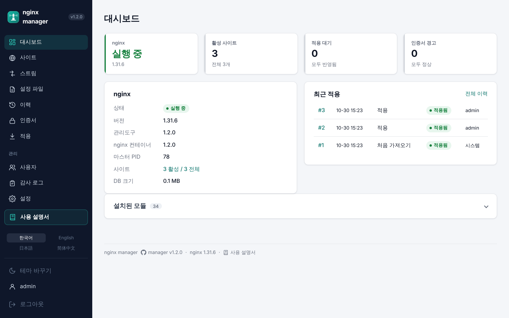
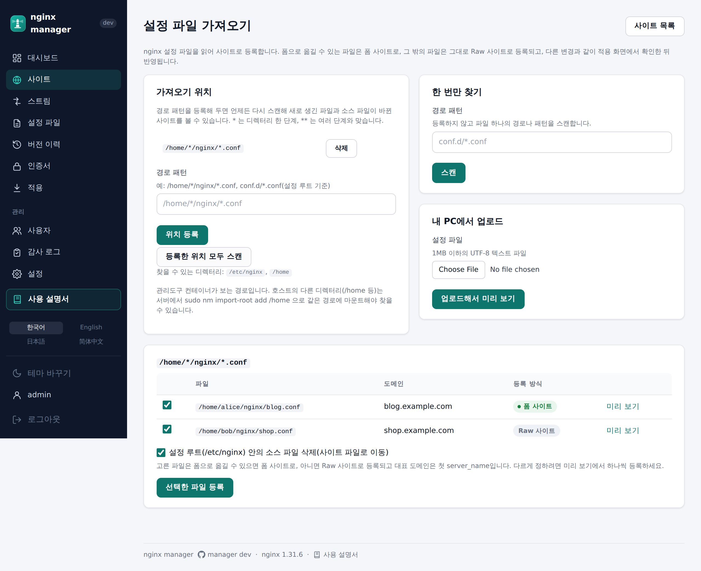
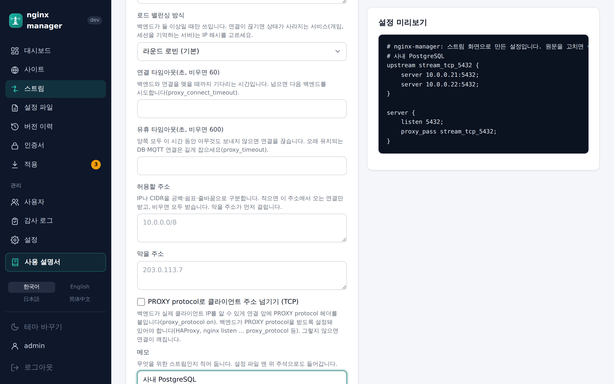
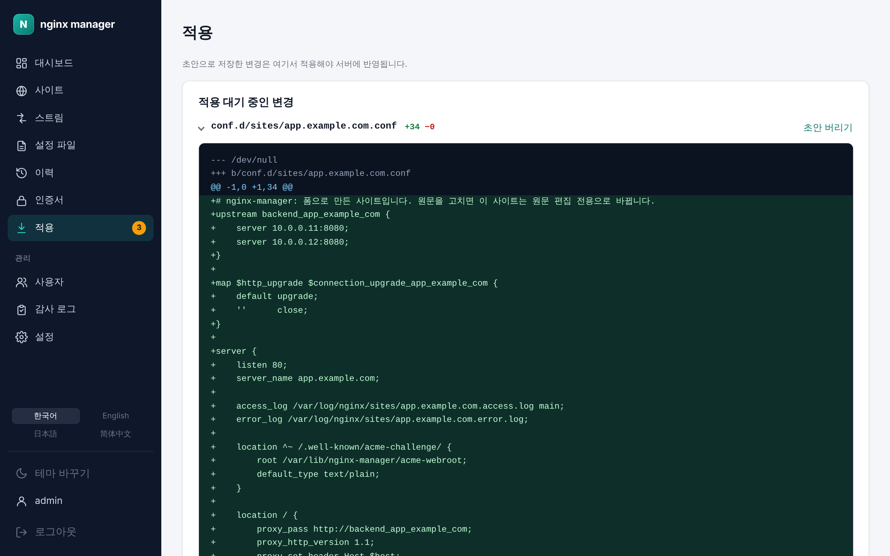
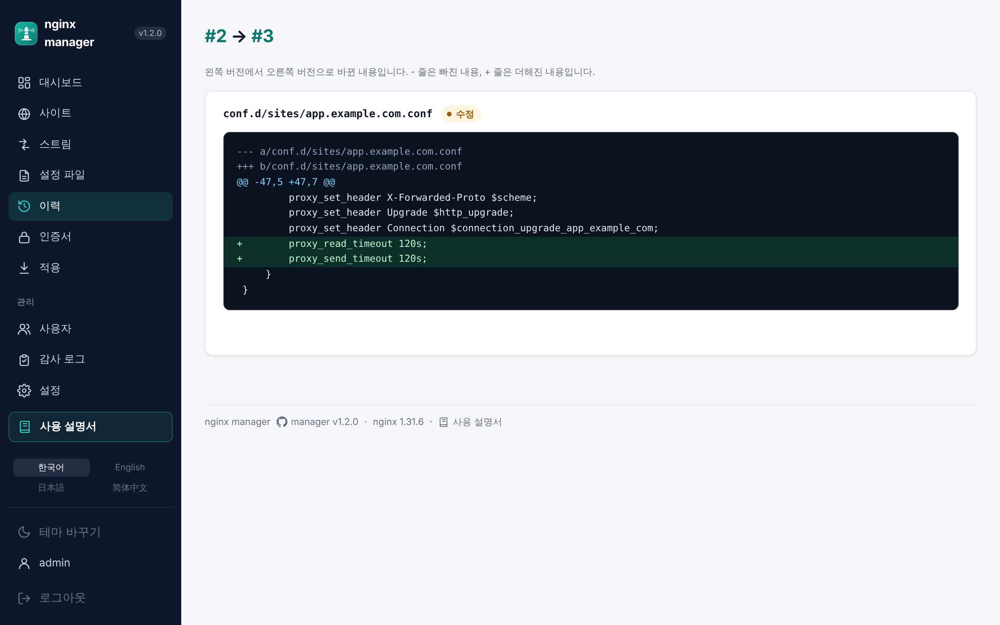
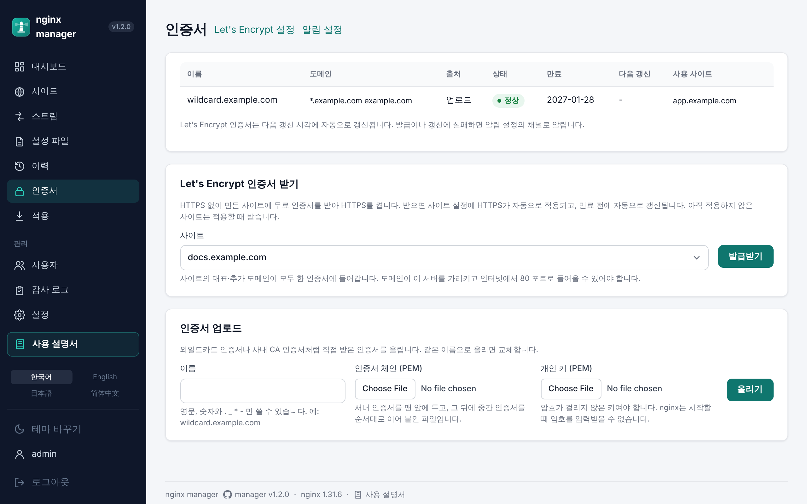
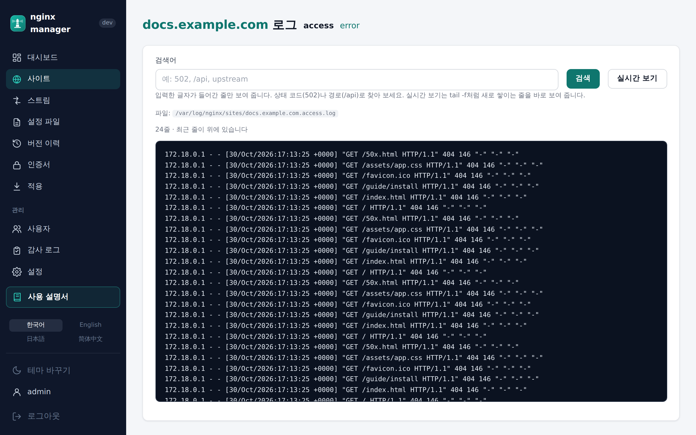
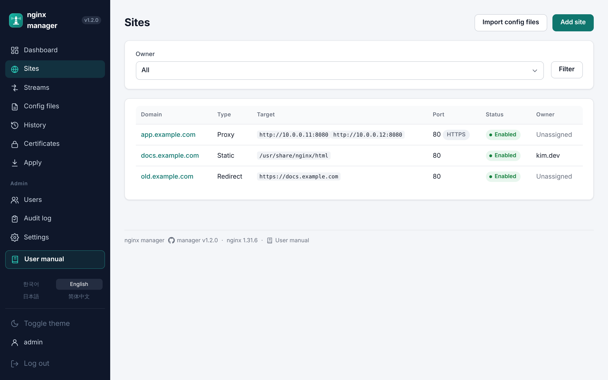

<div align="center">

[한국어](README.md) · **English** · [日本語](README.ja.md) · [简体中文](README.zh-CN.md)

# nginx manager

**Stop taking sites down by hand-editing config files. Review and apply changes in the browser, and if anything fails, it rolls back on its own.**

A web-based nginx manager that runs nginx and its admin UI as two containers

[](https://github.com/nginx-manager/app/releases/tag/v1.2.3)
[](https://nginx.org/en/CHANGES)
[](#four-languages-and-dark-mode)

[Install on a server](#install-on-a-server) · [Features](#features) · [Release notes](https://github.com/nginx-manager/app/blob/main/docs/releases/README.md) · [Repository](https://github.com/nginx-manager/app)

</div>

<p align="center">
  
</p>

## Contents

- [Why nginx manager](#why-nginx-manager)
- [Install on a server](#install-on-a-server)
- [Features](#features)
- [Architecture](#architecture)
- [Repositories](#repositories)
- [Releases](#releases)

## Why nginx manager

| | Editing on the server | nginx manager |
| --- | --- | --- |
| Adding a site | Write config files by hand | Reverse proxies, static sites and TCP/UDP streams **from a form**, with a live preview of the generated config |
| Applying | `nginx -t`, reload, and recover by hand if it fails | **Review the diff → validate → reload → check health**; if any step fails, **the previous config is restored automatically** |
| History | Keep backup files yourself | Every apply is saved as a **version** you can compare and roll back to; files changed directly on the server are detected |
| HTTPS | Install certbot and schedule renewals | Turn on HTTPS for a site and **Let's Encrypt issuance, setup and renewal** happen automatically |
| Logs | SSH in and `tail` | **Search and live-tail** each site's access/error logs in the browser |
| Access | Shared server accounts | Admin and member roles, members manage **only their own sites**, and **every change is in the audit log** |

## Install on a server

You need Docker Engine with Compose v2, sudo, and free ports 80 and 443. To use an admin domain, its DNS must point to the server and port 80 must be reachable from the internet.

This one line installs to `/opt/nginx-manager` and starts it.

```bash
curl -fsSL https://github.com/nginx-manager/app/releases/latest/download/install.sh \
  | sudo sh -s -- --admin-domain nm.example.com --email ops@example.com
```

- With `--admin-domain`, the admin UI is served on that domain: a Let's Encrypt certificate is issued, port 80 redirects to 443, and the admin UI is HTTPS only.
- Without a domain, the admin UI listens only on `http://127.0.0.1:9000` on the server. Connect with `ssh -L 9000:127.0.0.1:9000 <server>` and open `http://localhost:9000`.
- On first visit you create the first admin account.
- To import existing config such as `/home/*/nginx`, install with `--import-root /home`. After installing, use `./nm import-root add /home`.
- Other options: `--version X.Y.Z` (pin a version), `--dir` (install location), `--http-port`, `--https-port`, `--manager-port`, `--bundle FILE` (servers without internet access).

### Settings (`/opt/nginx-manager/.env`)

The installer creates `/opt/nginx-manager/.env`. After editing it, run `./nm restart`, or `./nm restart nginx` if you changed nginx ports.

| Variable | Default | When to change it |
| --- | --- | --- |
| `MANAGER_VERSION`, `NGINX_IMAGE` | Installed version | Don't edit by hand; `nm upgrade` changes them |
| `NGINX_MANAGER_ADMIN_DOMAIN` | Empty | To serve the admin UI on `https://<domain>` |
| `NGINX_MANAGER_ADMIN_EMAIL` | Empty | Let's Encrypt contact email |
| `NGINX_MANAGER_ADMIN_ALLOW` | Empty (allow all) | To limit who can reach the admin domain, as CIDRs |
| `NGINX_MANAGER_PORT` | `9000` | When port 9000 is already in use |
| `NGINX_MANAGER_BIND_ADDRESS` | `127.0.0.1` | To open the admin UI on an internal network without a domain (`0.0.0.0` or an internal IP) |
| `NGINX_HTTP_PORT`, `NGINX_HTTPS_PORT` | `80`, `443` | When a proxy in front already uses 80/443 |
| `NGINX_BIND_ADDRESS` | `0.0.0.0` | To serve nginx on one IP only |
| `NGINX_MANAGER_BACKUP_KEEP` | `14` | Number of `nm backup` files to keep |
| `TZ` | `Asia/Seoul` | Time zone |
| `NGINX_MANAGER_IMPORT_ROOTS` | Empty | To import config files from outside `/etc/nginx` |
| `SPRING_MAIL_*` | Empty | SMTP server for email alerts |

### Commands

```bash
cd /opt/nginx-manager
./nm status            # status and versions
./nm restart           # restart after editing .env
./nm upgrade           # upgrade the admin UI only (nginx keeps serving traffic)
./nm upgrade --nginx   # upgrade nginx too (config is validated with the new nginx first; restarts in seconds)
./nm backup            # back up config and database
./nm restore backups/<file>
./nm migrate           # move over from v1.0/v1.1 (install with --no-start first)
./nm import-root check # check the import directory is readable (grant gives read access if not)
```

Details are in [chapter 1 of the user guide, Installation](https://github.com/nginx-manager/app/blob/main/src/main/resources/guide/ko/01-install.md) (Korean).

## Features

### Sites from a form

Set multiple backends (load balancing), WebSocket, timeouts, redirects and even HTTP/3 in a form, and see the generated nginx config right beside it. Anything the form doesn't cover can be edited in the raw editor with nginx syntax highlighting.

<p align="center"></p>

### Import existing config files

Register a path pattern such as `/home/*/nginx/*.conf` and every matching file is found and registered as a site in one go. Files that fit the form become form sites; the rest are kept as raw sites. You're told when an original file changes.

<p align="center"></p>

### TCP/UDP streams

Forward non-HTTP services such as databases or MQTT by port.

<p align="center"></p>

### Review, then apply

Saved drafts are reviewed as per-file diffs before they go live. If validation, reload or the health check fails, the previous config comes back.

<p align="center"></p>

### History and rollback

Every apply is saved as a version. Compare any two versions or roll back to an earlier one.

<p align="center"></p>

### HTTPS certificates

Let's Encrypt certificates are issued automatically and renewed before they expire. If a renewal fails, you're alerted by email or webhook. Wildcard and internal certificates can be uploaded.

<p align="center"></p>

### Logs

Search or live-tail each site's access/error logs.

<p align="center"></p>

### Four languages and dark mode

Use the UI in Korean, English, Japanese or Simplified Chinese, and switch to a dark theme.

<p align="center"></p>

## Architecture

| Container | Image | Role |
| --- | --- | --- |
| `nginx` | `ghcr.io/nginx-manager/nginx` | nginx (open source, built with all modules) plus an agent. The agent only runs `nginx -t` and reload when the admin UI asks |
| `manager` | `ghcr.io/nginx-manager/app` | Admin UI (Spring Boot). Writes config files to the shared volume and leaves validation and reload to the agent |

nginx keeps serving traffic while the admin UI is upgraded or restarted. A new nginx image validates the config on the volume before nginx starts, and if it doesn't fit, the admin UI shows the file and line at fault. When nginx ships a new release, the nginx image is rebuilt, tested and published automatically, and older tags stay available.

## Repositories

| Repository | Description |
| --- | --- |
| [app](https://github.com/nginx-manager/app) | Admin UI (Spring Boot), nginx image and agent (Go), install bundle, release notes |

## Releases

Versions follow git tags (`vX.Y.Z`), starting at 1.0.0. Each version's changes and screenshots are in the [release notes](https://github.com/nginx-manager/app/blob/main/docs/releases/README.md) (Korean) and on [GitHub Releases](https://github.com/nginx-manager/app/releases). The running version is shown at the bottom of the admin UI.

<!-- releases:start -->
| Version | Date | Release notes |
| --- | --- | --- |
| v1.2.3 | 2026-10-30 | [v1.2.3](https://github.com/nginx-manager/app/blob/main/docs/releases/v1.2.3.md) |
| v1.2.2 | 2026-10-30 | [v1.2.2](https://github.com/nginx-manager/app/blob/main/docs/releases/v1.2.2.md) |
| v1.2.1 | 2026-10-30 | [v1.2.1](https://github.com/nginx-manager/app/blob/main/docs/releases/v1.2.1.md) |
| v1.2.0 | 2026-10-30 | [v1.2.0](https://github.com/nginx-manager/app/blob/main/docs/releases/v1.2.0.md) |
| v1.1.0 | 2026-10-29 | [v1.1.0](https://github.com/nginx-manager/app/blob/main/docs/releases/v1.1.0.md) |
| v1.0.0 | 2026-10-29 | [v1.0.0](https://github.com/nginx-manager/app/blob/main/docs/releases/v1.0.0.md) |
<!-- releases:end -->
