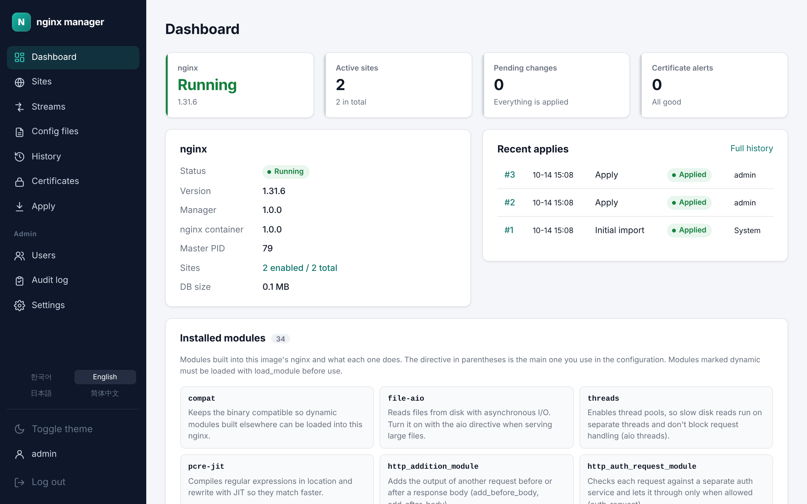

<div align="center">

# nginx manager

**설정 파일을 직접 고치다 사이트를 내리는 일은 이제 그만. 브라우저에서 확인하고 적용하고, 실패하면 알아서 되돌립니다.**

nginx와 관리 화면을 컨테이너 두 개로 띄우는 웹 기반 nginx 관리도구

[](https://github.com/nginx-manager/app/blob/main/docs/releases/README.md)
[](https://nginx.org/en/CHANGES)
[](#4개-언어와-다크-모드)

[빠르게 시작하기](#빠르게-시작하기) · [주요 기능](#주요-기능) · [릴리스 노트](https://github.com/nginx-manager/app/blob/main/docs/releases/README.md) · [저장소](https://github.com/nginx-manager/app)

</div>

<p align="center">
  
</p>

## 목차

- [왜 nginx manager인가](#왜-nginx-manager인가)
- [빠르게 시작하기](#빠르게-시작하기)
- [주요 기능](#주요-기능)
- [구성](#구성)
- [저장소](#저장소)
- [릴리스](#릴리스)

## 왜 nginx manager인가

| | 서버에서 직접 고치기 | nginx manager |
| --- | --- | --- |
| 사이트 추가 | 설정 파일을 손으로 작성 | 리버스 프록시·정적 사이트·TCP/UDP 스트림을 **폼으로**, 만들어질 설정을 바로 미리보기 |
| 반영 | `nginx -t` 후 reload, 실패하면 손으로 복구 | **diff 확인 → 검증 → reload → 상태 확인**, 어느 단계든 실패하면 **자동으로 직전 설정 복구** |
| 이력 | 백업 파일을 직접 관리 | 적용할 때마다 **버전**이 남고 비교·되돌리기, 서버에서 직접 바뀐 파일도 감지 |
| HTTPS | certbot 설치와 갱신 스케줄 | 사이트에서 HTTPS를 고르면 **Let's Encrypt 발급·적용·갱신**까지 자동 |
| 로그 | 서버에 접속해 `tail` | 사이트별 access/error 로그를 **화면에서 검색·실시간 보기** |
| 권한 | 서버 계정 공유 | 관리자·편집자·조회자 역할, **모든 변경은 감사 로그**에 기록 |

## 빠르게 시작하기

```bash
curl -fsSLO https://raw.githubusercontent.com/nginx-manager/app/main/docker/docker-compose.yml
docker compose up -d
```

`http://<호스트>:9000`에 접속하면 최초 관리자 계정을 만드는 화면이 나옵니다. 처음 시작할 때 `/etc/nginx`에 이미 있는 설정을 가져와 첫 버전으로 남깁니다. 관리 화면은 인터넷에 그대로 열지 말고 사내망·VPN이나 HTTPS 프록시 뒤에 두세요.

## 주요 기능

### 사이트를 폼으로

백엔드 여러 개(부하 분산), 웹소켓, 타임아웃, 리디렉션, HTTP/3까지 폼에서 정하고, 만들어질 nginx 설정을 옆에서 바로 봅니다. 폼으로 표현하지 않는 설정은 원문 편집기(nginx 문법 강조)로 고칩니다.

<p align="center"></p>

### TCP/UDP 스트림

데이터베이스, MQTT처럼 HTTP가 아닌 서비스도 포트 단위로 넘깁니다.

<p align="center"></p>

### 확인하고 적용하기

저장한 초안은 파일별 diff로 확인한 뒤 반영합니다. 검증·reload·상태 확인 중 하나라도 실패하면 직전 설정으로 돌아갑니다.

<p align="center"></p>

### 이력과 되돌리기

적용할 때마다 버전이 남고, 두 버전을 비교하거나 이전 버전으로 되돌립니다.

<p align="center"></p>

### HTTPS 인증서

Let's Encrypt 인증서를 자동으로 받고 만료 전에 갱신합니다. 갱신에 실패하면 메일·웹훅으로 알립니다. 와일드카드·사내 인증서는 업로드합니다.

<p align="center"></p>

### 로그

사이트별 access/error 로그를 검색하거나 실시간으로 봅니다.

<p align="center"></p>

### 4개 언어와 다크 모드

화면을 한국어·영어·일본어·중국어(간체)로 볼 수 있고, 어두운 테마로 바꿀 수 있습니다.

<p align="center"></p>

## 구성

| 컨테이너 | 이미지 | 하는 일 |
| --- | --- | --- |
| `nginx` | `ghcr.io/nginx-manager/nginx` | nginx(오픈소스, 전체 모듈 빌드)와 에이전트. 에이전트는 관리 화면의 요청으로 `nginx -t`·reload만 실행합니다 |
| `manager` | `ghcr.io/nginx-manager/app` | 관리 화면(Spring Boot). 설정 파일은 공유 볼륨에 직접 쓰고, 검증·reload는 에이전트에 맡깁니다 |

관리 화면을 업데이트하거나 다시 띄워도 nginx는 계속 트래픽을 받습니다. 새 nginx 이미지는 nginx를 띄우기 전에 볼륨의 설정을 검증하고, 맞지 않으면 관리 화면이 문제의 파일·줄을 보여 줍니다. nginx 새 릴리스가 나오면 nginx 이미지가 자동으로 다시 빌드·테스트·게시되고, 이전 태그는 그대로 남습니다.

## 저장소

| 저장소 | 설명 |
| --- | --- |
| [app](https://github.com/nginx-manager/app) | 관리 화면(Spring Boot), nginx 이미지와 에이전트(Go), compose 파일, 릴리스 노트 |

## 릴리스

버전은 git 태그(`vX.Y.Z`)로 관리하고, 1.0.0부터 시작합니다. 버전마다 [릴리스 노트](https://github.com/nginx-manager/app/blob/main/docs/releases/README.md)에 바뀐 내용과 화면을 정리합니다. 지금 쓰는 버전은 관리 화면 아래(footer)에 보입니다.

| 버전 | 날짜 | 주요 내용 | 릴리스 노트 |
| --- | --- | --- | --- |
| v1.0.0 | 출시 예정 | 첫 정식 릴리스: 폼으로 사이트·TCP/UDP 스트림 만들기, 검증 후 적용과 자동 복구, 이력·비교·되돌리기, Let's Encrypt 자동 발급·갱신, 대시보드와 로그, 4개 언어·다크 모드, 사용자·감사 로그, 컨테이너 두 개와 업그레이드 안전장치 | [초안 보기](https://github.com/nginx-manager/app/blob/main/docs/releases/v1.0.0.md) |
